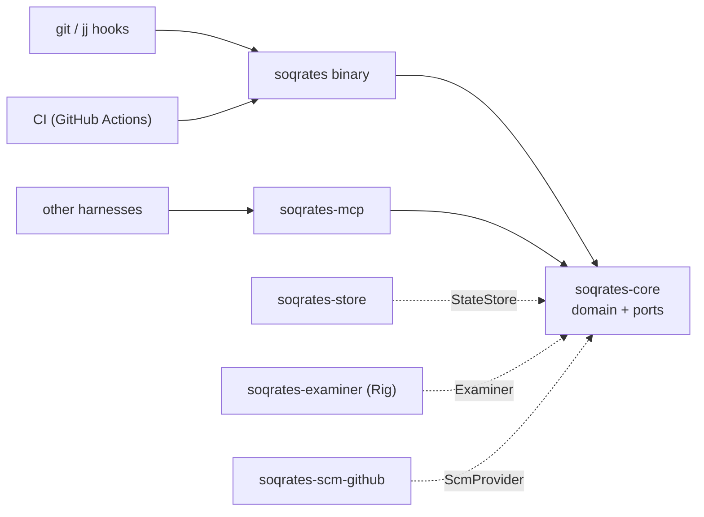

# soqrates

A learning companion for code changes. Soqrates quizzes the author of a change
about the concepts in it, adapting to their level and using spaced
repetition, so that changes don't pile up cognitive debt. It runs as a PR
check in CI, as a git `pre-commit` / jj `pre-push` hook, or inside your own
agent harness through its skills and MCP server.

> Status: architecture skeleton. Behaviour is specified, not yet implemented.

## Architecture

See [ADR-0001](docs/adr/0001-agent-framework-and-architecture.md#architecture-overview)
for the architecture and [ADR-0002](docs/adr/0002-domain-model.md) for the
domain model (glossary, contexts, aggregates, events).



## Layout

| Path | What |
|---|---|
| `docs/adr/` | Architecture decision records. Every decision is numbered and has an enforcement mode. |
| `crates/soqrates-core` | Domain contexts (`assessment`, `learner`, `delivery`) and the `app` layer with the ports. No I/O. |
| `crates/soqrates-store` | State adapters (in-memory, JSON files). |
| `crates/soqrates-examiner` | `Examiner` on top of Rig: any LLM provider. |
| `crates/soqrates-scm-github` | `ScmProvider` for GitHub. |
| `crates/soqrates-mcp` | MCP server exposing the core. |
| `crates/soqrates-cli` | The `soqrates` binary. |
| `crates/soqrates-spec` | Executable ADRs: architecture tests, traceability, BDD acceptance tests. |
| `skills/` | Portable `SKILL.md` skills. |
| `evals/` | Eval harness and benchmarks (Python, Inspect AI). |

## Executable ADRs

ADRs in this repo are enforced by tests:

- **Architecture fitness tests** (`crates/soqrates-spec/tests/architecture.rs`)
  check structural decisions against `cargo metadata`, for example that only
  `soqrates-examiner` may depend on Rig.
- **BDD acceptance tests** (`crates/soqrates-spec/features/*.feature`)
  specify behaviour in Gherkin, are tagged with the decision they enforce
  (`@adr-0001-d7`), and are written *before* the implementation.
- **Traceability**: the build fails if an `automated` decision has no tagged
  test, or if a test references a decision that doesn't exist.
- **Ratchet**: new scenarios are tagged `@wip`. CI requires every
  scenario without `@wip` to pass. When you implement a behaviour, remove its
  `@wip` tag; from then on it can't regress.

```sh
cargo test -p soqrates-spec --test architecture -- --nocapture  # fitness + traceability report
cargo test -p soqrates-spec --test acceptance                   # ratchet: non-@wip scenarios
SOQRATES_SPEC_ALL=1 cargo test -p soqrates-spec --test acceptance  # whole backlog, red/green
```

To add a decision: write an ADR (or a new `### Dn:` section) with an
`**Enforcement:**` line, then add tagged tests or scenarios until traceability
passes.
