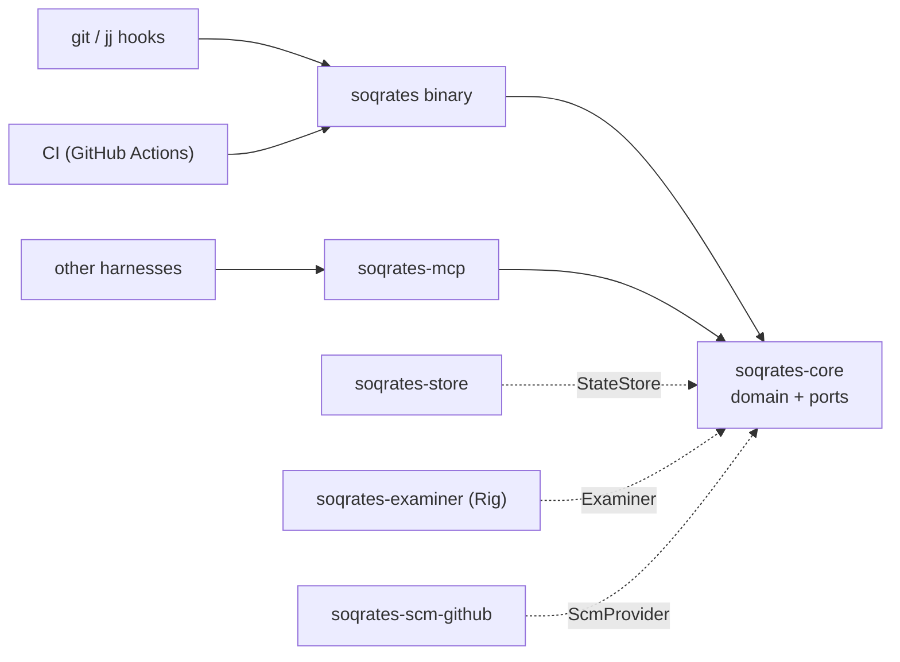

<p align="center">
  <picture>
    <source media="(prefers-color-scheme: dark)" srcset="assets/logo/soqrates-lockup-dark.svg">
    
  </picture>
</p>

# soqrates

A learning companion for code changes. Soqrates quizzes the author of a change
about the concepts in it, adapting to their level and using spaced
repetition, so that changes don't pile up cognitive debt. It runs as a PR
check in CI, as a git `pre-commit` / jj `pre-push` hook, or inside your own
agent harness through its skills and MCP server.

> Status: early. The domain is implemented and specified by 200+ executable
> scenarios. Soqrates checks its own pull requests (advisory).

## Using it

```sh
cargo install --path crates/soqrates-cli      # installs `soqrates`
export ANTHROPIC_API_KEY=...                  # or SOQRATES_MODEL=ollama:<model>

soqrates install-hook                         # git: quiz yourself on each commit
soqrates hook pre-push                        # jj: run before `jj git push`
soqrates identity use github.com:<your id>    # identity for repos on that forge
soqrates mcp                                  # MCP server for other harnesses
```

Configuration lives in `~/.config/soqrates/config.toml`, overlaid by
`.soqrates.toml` in the repository:

```toml
model = "anthropic:claude-sonnet-5-5"
mode = "advisory"          # or "blocking"
max_questions = 5          # a cap: rounds ask only what the change and your history call for
open_questions = false     # true: experts get open questions; off by default, so everyone gets multiple choice
[identities]
"github.com" = "github.com:1001"
```

Learner state is kept as JSON files in the platform data directory
(`--state-dir` to change it), or in a database when `SOQRATES_DATABASE_URL`
is set ([ADR-0005](docs/adr/0005-sql-database-store.md)):

```sh
export SOQRATES_DATABASE_URL='sqlite:///home/me/soqrates.db?mode=rwc'  # one local file
export SOQRATES_DATABASE_URL='postgres://soqrates@db.example.com/soqrates?sslmode=require'  # shared
```

The tables are created on first use. The URL is only read from the
environment or `--database-url`, never from a config file, since it may
hold a password.

### In your repository

Add the Soqrates GitHub Action to any repository: an `ANTHROPIC_API_KEY`
secret and one workflow file, given in full in
[docs/using-the-action.md](docs/using-the-action.md):

```yaml
      - uses: jvanbuel/soqrates@v0
        with:
          anthropic-api-key: ${{ secrets.ANTHROPIC_API_KEY }}
```

The action downloads a released `soqrates` binary and checks its checksum
and build provenance; it never builds or runs anything from your code. The
pull request diff goes to your model provider, along with the code the
examiner chooses to read (files, grep results, git log and blame) from a
checkout of the PR head that is only read, never built or run
([ADR-0008](docs/adr/0008-examiner-reads-the-codebase.md)). Learner state
stays on a branch of your repository or in your own database
([ADR-0006](docs/adr/0006-distribution-as-a-github-action.md)).

### As a PR check on this repository

[`.github/workflows/soqrates.yml`](.github/workflows/soqrates.yml) runs the
action from this checkout (`uses: ./`), with `soqrates` built from source,
on every PR, and posts the questions as a PR comment (ADR-0004):

- **Multiple choice:** tick one option per question.
- **Open questions** (asked only of experts, and only with `open_questions`
  on): edit the comment and type your answer into the field under the
  question, between its `soqrates:answer` lines.
- Then tick **Grade my answers**, which submits everything at once.
- Authors who can't edit the comment answer with a comment instead:

  ```
  /soqrates answer
  1. b
  2. Your answer in your own words
  ```

  `/socrates answer`, any letter case and, when posting as an app,
  `@<app slug> answer` work too. A mistyped command gets a hint; fix it by
  editing the comment. While grading, the submitting comment shows 👀.

After grading, Soqrates posts a results comment: ✅/❌ per question, the
correct option and an explanation. It shows this session only; your level
and review schedule stay private, shown only in the terminal and the MCP
client.

To post as **soqrates[bot]** with the Soqrates logo instead of
github-actions[bot], set up the Soqrates GitHub App
([docs/github-app.md](docs/github-app.md)).

It needs an `ANTHROPIC_API_KEY` repository secret, and keeps learner state
on the `soqrates-state` branch. Anyone who can read the repository can read
that branch, including what each author got wrong.

## Architecture

See [ADR-0001](docs/adr/0001-agent-framework-and-architecture.md#architecture-overview)
for the architecture and [ADR-0002](docs/adr/0002-domain-model.md) for the
domain model (glossary, contexts, aggregates, events).



## Layout

| Path | What |
|---|---|
| `docs/adr/` | Architecture decision records. Every decision is numbered and has an enforcement mode. |
| `crates/soqrates-core` | Domain contexts (`assessment`, `learner`, `delivery`) and the `app` layer with the ports. No I/O. |
| `crates/soqrates-store` | State adapters (in-memory, JSON files, and SQLite or PostgreSQL behind the `sqlite` and `postgres` features). |
| `crates/soqrates-examiner` | `Examiner` on top of Rig: any LLM provider. |
| `crates/soqrates-scm-github` | `ScmProvider` for GitHub. |
| `crates/soqrates-mcp` | MCP server exposing the core. |
| `crates/soqrates-cli` | The `soqrates` binary. |
| `crates/soqrates-spec` | Executable ADRs: architecture tests, traceability, BDD acceptance tests. |
| `action.yml`, `action/` | The Soqrates GitHub Action and its scripts (ADR-0006). |
| `release-plz.toml`, `.github/workflows/release-plz.yml` | Release PRs, tags and changelog with release-plz ([docs/releasing.md](docs/releasing.md)). |
| `.github/workflows/release.yml` | Builds, attests and attaches the release binaries the action runs. |
| `skills/` | Portable `SKILL.md` skills. |
| `evals/` | Eval harness and benchmarks (Python, Inspect AI). |
| `assets/logo/` | The logo: a question mark drawn as git history, with the merge commit as its dot. |

## Executable ADRs

ADRs in this repo are enforced by tests:

- **Architecture fitness tests** (`crates/soqrates-spec/tests/architecture.rs`)
  check structural decisions against `cargo metadata`, for example that only
  `soqrates-examiner` may depend on Rig.
- **BDD acceptance tests** (`crates/soqrates-spec/features/*.feature`)
  specify behaviour in Gherkin, are tagged with the decision they enforce
  (`@adr-0001-d7`), and are written *before* the implementation.
- **Traceability**: the build fails if an `automated` decision has no tagged
  test, or if a test references a decision that doesn't exist.
- **Ratchet**: new scenarios are tagged `@wip`. CI requires every
  scenario without `@wip` to pass. When you implement a behaviour, remove its
  `@wip` tag; from then on it can't regress.

```sh
cargo test -p soqrates-spec --test architecture -- --nocapture  # fitness + traceability report
cargo test -p soqrates-spec --test acceptance                   # ratchet: non-@wip scenarios
SOQRATES_SPEC_ALL=1 cargo test -p soqrates-spec --test acceptance  # whole backlog, red/green
```

To add a decision: write an ADR (or a new `### Dn:` section) with an
`**Enforcement:**` line, then add tagged tests or scenarios until traceability
passes.
