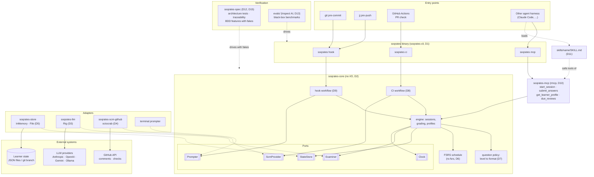
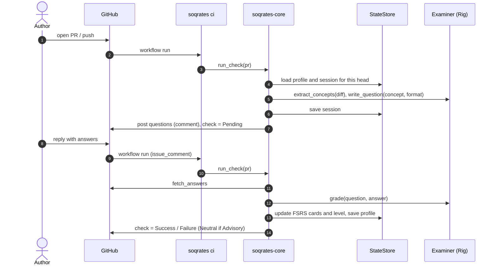

# ADR-0001: Agent framework and architecture

- **Status:** Accepted
- **Date:** 2026-11-07

## Context

Soqrates is a learning companion for code changes. It quizzes the author of a
change about the concepts in it, so that AI-assisted (or human) changes do not
pile up *cognitive debt*: code that ships but that nobody understands.

It must:

- run in CI as a pull-request check, and locally as a git `pre-commit` hook or
  a jj `pre-push` hook;
- keep state about each author to gauge their knowledge level;
- use spaced repetition (also stateful) to improve retention;
- ask beginners mostly multiple-choice questions and experts open questions;
- work with different LLM providers and different CI/SCM providers;
- be usable from other agent harnesses through skills and an MCP server;
- be measured with evals and benchmarks, and be used to develop itself.

We considered Python (Pydantic AI, LangGraph, the OpenAI and Claude Agent SDKs)
and Rust (Rig, rmcp). Python's lead is mostly in complex multi-agent
orchestration, which Soqrates does not need: its agent loop is small (read the
diff, load the profile, ask, grade, reschedule). Rust gives a single static
binary with no runtime to install, which matters most for git hooks, and FSRS's
reference implementations are in Rust.

## Architecture overview

Solid arrows are calls or dependencies. Dotted arrows mean "implements a
port". Only `soqrates-core` sits in the middle, and it knows nothing about
the outside world (D2).

The CI check (D8) is asynchronous: questions and answers pass through PR
comments over several workflow runs.

## Decisions

Every decision has an ID. An `automated` decision must be covered by at least
one test tagged with that ID: a Gherkin tag such as `@adr-0001-d2` in
`crates/soqrates-spec/features/`, or a comment such as `// @adr-0001-d2` in
`crates/soqrates-spec/tests/`. The traceability test (`adr-0001-d15`) fails
the build if one is missing. A `manual` decision is checked in review and must
say why it is not automated yet.

### D1: Rust workspace that ships one binary
**Enforcement:** automated

Soqrates is a Cargo workspace. The user-facing entry point is a single binary
named `soqrates` (crate `soqrates-cli`) with the subcommands `hook`, `ci` and
`mcp`.

### D2: Hexagonal core with no I/O dependencies
**Enforcement:** automated

`soqrates-core` holds the domain (learner model, question policy, scheduling,
the CI and hook workflows) and defines the *ports* `StateStore`, `Examiner`,
`ScmProvider`, `Clock` and `Prompter`. It depends on no other workspace crate
and only on this allowlist: `rs-fsrs`, `chrono`, `serde`, `serde_json`,
`thiserror`. Adapters live in their own crates.

### D3: LLM access through Rig, confined to `soqrates-llm`
**Enforcement:** automated

`soqrates-llm` implements `Examiner` on top of [Rig](https://github.com/0xPlaygrounds/rig)
(`rig-core`), which gives us many providers (Anthropic, OpenAI, Gemini,
Ollama, ...). It is the only crate that may depend on `rig-core`, so Rig can be
swapped out by replacing one crate.

### D4: SCM/CI providers behind `ScmProvider`; GitHub first
**Enforcement:** automated

CI and SCM interaction goes through the `ScmProvider` port (fetch a PR, post
questions, read answers, set a check status). The first adapter is
`soqrates-scm-github`, using `octocrab`. It is the only crate that may depend
on `octocrab`. Other providers (GitLab, Forgejo, ...) are new adapter crates.

### D5: Per-author state behind `StateStore`
**Enforcement:** automated

Learner profiles and pending sessions are persisted through the `StateStore`
port, keyed by a stable `AuthorId` (a forge user ID such as `github:12345`, or
`email:<address>` locally). Profiles of different authors never affect each
other, and a profile survives across sessions. `soqrates-store` provides an
in-memory store and a file store (one JSON document per author). A
git-branch store and a hosted store can be added later behind the same port.

### D6: Spaced repetition with FSRS
**Enforcement:** automated

Every concept an author is quizzed on becomes a review card scheduled with
FSRS (the `rs-fsrs` crate, a scheduler with no ML-training dependencies). A
correct answer pushes the next review further out than a wrong one. Concepts
whose reviews are due are asked again in the author's next session, before
new concepts and within the session's question budget.

### D7: Question format adapts to the author's level
**Enforcement:** automated

Each profile has a `Level` (`Novice`, `Intermediate`, `Expert`). New authors
start as `Novice`. Novices get multiple-choice questions, experts get open
questions, and intermediates get a mix. The level goes up after sustained
correct answers and down after sustained wrong ones.

### D8: CI check is an asynchronous round trip
**Enforcement:** automated

In CI the questions cannot be answered at the terminal. The first run on a PR
head creates a session, posts the questions as a PR comment and sets the check
to `Pending`. A later run (for example, when the author replies) reads the
answers, grades them, updates the profile and sets the check to `Success` or
`Failure`. In `Advisory` mode a failed quiz sets `Neutral` instead of
`Failure`. A new push to the PR starts a new session for the new head.

### D9: Local hooks share one entry point
**Enforcement:** automated

`soqrates hook pre-commit` (git) and `soqrates hook pre-push` (jj) both run
the same local workflow: quiz the author at the terminal through the
`Prompter` port, then allow or block. The default is `Advisory`: report the
result, always allow. In `Blocking` mode a failed quiz blocks the commit or
push. An empty diff never asks any questions.

### D10: The core is exposed as an MCP server
**Enforcement:** automated

`soqrates-mcp` exposes the core through MCP using `rmcp`, the official Rust
SDK, with exactly these tools: `start_session`, `submit_answers`,
`get_learner_profile` and `due_reviews`. Other harnesses get the same learner
model and scheduling as the Soqrates agent. The agent is just one client.

### D11: Skills are portable `SKILL.md` files
**Enforcement:** automated

Skills live in `skills/<name>/SKILL.md`, with YAML frontmatter containing at
least `name` (equal to the directory name) and `description`. They do not
depend on any particular harness.

### D12: Tests are hermetic
**Enforcement:** automated

Acceptance and architecture tests use fakes for `Examiner`, `ScmProvider`,
`Clock` and `Prompter`, and never call a real model or forge. The spec crate
must not depend on `soqrates-llm` or `soqrates-scm-github`.

### D13: Evals and benchmarks live in `evals/` and treat Soqrates as a black box
**Enforcement:** manual. Nothing can run until there is a working binary.

Quality is measured by a Python eval harness ([Inspect AI](https://inspect.aisi.org.uk/))
under `evals/`, driving the `soqrates` binary or MCP server with a fixed
dataset of diffs, labelled concepts and simulated authors of various levels.
Tracked metrics: question relevance to the diff, how well difficulty matches
the level, how often the grader agrees with human labels, and simulated
retention over repeated sessions. Evals run on every PR that touches prompts
or the core.

### D14: Soqrates is dogfooded
**Enforcement:** manual. This needs D8 to be implemented first.

Soqrates runs as a PR check on its own repository, in `Advisory` mode at
first.

### D15: ADRs are executable
**Enforcement:** automated

Every `automated` decision in an accepted ADR is referenced by at least one
test. New behaviour scenarios start tagged `@wip`. CI requires every
scenario without `@wip` to pass, and a scenario's `@wip` tag is removed once
it passes, so behaviours can only move from failing to passing (a ratchet).

## Consequences

- Fast, dependency-free hooks and CI, and FSRS without a Python runtime.
- Swapping the LLM framework or adding a forge touches one adapter crate.
- The architecture tests catch architectural drift (for example, core
  importing `octocrab`) in CI rather than in review.
- Evals are in Python, so the repository has two toolchains. That is
  acceptable because evals only use the public binary or MCP interface.
- Rig is younger than the Python frameworks. Confining it to one crate
  (D3) limits the risk.
