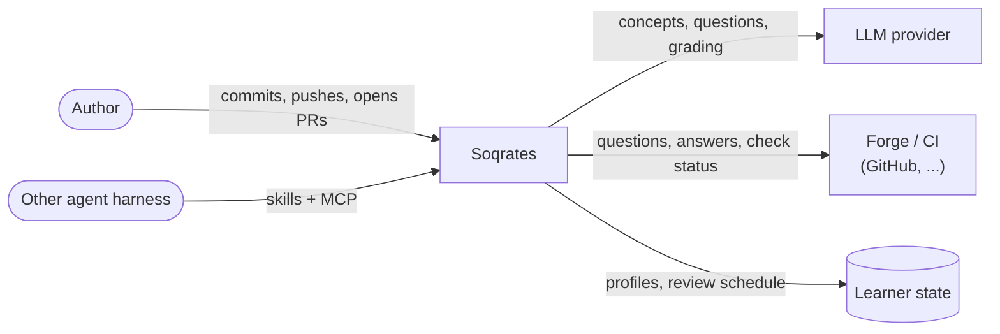
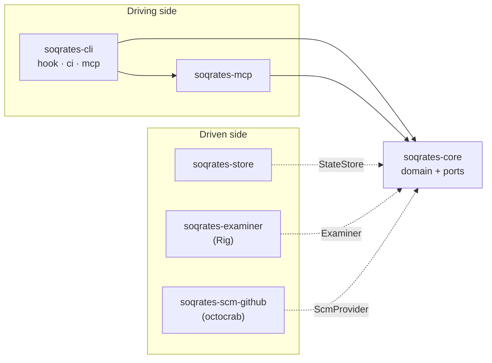
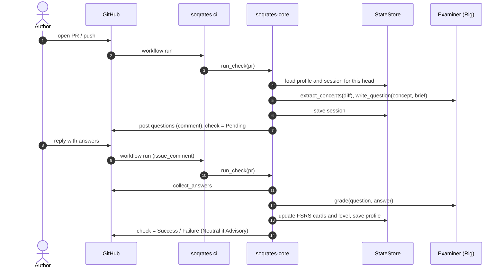

# ADR-0001: Agent framework and architecture

- **Status:** Accepted
- **Date:** 2026-11-07

## Context

Soqrates is a learning companion for code changes. It quizzes the author of a
change about the concepts in it, so that AI-assisted (or human) changes do not
pile up *cognitive debt*: code that ships but that nobody understands.

It must:

- run in CI as a pull-request check, and locally as a git `pre-commit` hook or
  a jj `pre-push` hook;
- keep state about each author to gauge their knowledge level;
- use spaced repetition (also stateful) to improve retention;
- ask beginners mostly multiple-choice questions and experts open questions;
- work with different LLM providers and different CI/SCM providers;
- be usable from other agent harnesses through skills and an MCP server;
- be measured with evals and benchmarks, and be used to develop itself.

We considered Python (Pydantic AI, LangGraph, the OpenAI and Claude Agent SDKs)
and Rust (Rig, rmcp). Python's lead is mostly in complex multi-agent
orchestration, which Soqrates does not need: its agent loop is small (read the
diff, load the profile, ask, grade, reschedule). Rust gives a single static
binary with no runtime to install, which matters most for git hooks, and FSRS's
reference implementations are in Rust.

## Architecture overview

Three zoom levels. Each diagram answers one question.

### Level 1: context. Who uses Soqrates and what it talks to.

### Level 2: crates. A hexagon: the core defines ports, adapters implement them.

Arrows point toward the core: it depends on nothing in the workspace (D2),
and each third-party framework lives in exactly one adapter (D3, D4, D10).
`soqrates-spec` tests the core with fakes for every port (D12).

### Level 3: inside the core

[ADR-0002](0002-domain-model.md#contexts) structures the core into the
contexts `assessment`, `learner` and `delivery`, plus an `app` layer, and
defines the domain language.

### CI check flow

The CI check (D8) is asynchronous: questions and answers pass through PR
comments over several workflow runs.

## Decisions

Every decision has an ID. An `automated` decision must be covered by at least
one test tagged with that ID: a Gherkin tag such as `@adr-0001-d2` in
`crates/soqrates-spec/features/`, or a comment such as `// @adr-0001-d2`
directly above a test in any crate's `src/` or `tests/`. The traceability test (`adr-0001-d15`) fails
the build if one is missing. A `manual` decision is checked in review and must
say why it is not automated yet.

### D1: Rust workspace that ships one binary
**Enforcement:** automated

Soqrates is a Cargo workspace. The user-facing entry point is a single binary
named `soqrates` (crate `soqrates-cli`) with the subcommands `hook`, `ci` and
`mcp`.

### D2: Hexagonal core with no I/O dependencies
**Enforcement:** automated

`soqrates-core` holds the domain (learner profiles, question policy, scheduling,
the CI and hook workflows) and defines the *ports* `StateStore`,
`DocumentStore`, `Examiner`, `ScmProvider`, `Clock` and `Prompter`. It depends on no other workspace crate
and only on this allowlist: `rs-fsrs`, `chrono`, `serde`, `serde_json`,
`thiserror`. Adapters live in their own crates.

### D3: LLM access through Rig, confined to `soqrates-examiner`
**Enforcement:** automated

[Rig](https://github.com/0xPlaygrounds/rig) (`rig-core`) is the provider
layer: it already abstracts Anthropic, OpenAI, Gemini, Ollama and others.
Soqrates does not add a provider abstraction of its own.

`soqrates-examiner` implements the `Examiner` port on top of Rig. It holds
Soqrates's own LLM logic: the prompts and output schemas for extracting
concepts, writing questions and grading answers; parsing and validating
model replies; and picking a model from configuration (e.g.
`anthropic:claude-sonnet-5-5`). It is a separate crate, rather than a module
in the binary, so that:

- the core and its tests never compile Rig, and confinement is checkable;
- the evals (D13) can exercise the examiner on its own;
- Rig can be swapped out by replacing one crate.

It is the only crate that may depend on `rig-core`.

### D4: SCM/CI providers behind `ScmProvider`; GitHub first
**Enforcement:** automated

CI and SCM interaction goes through the `ScmProvider` port (fetch a PR,
publish questions, collect answers, set a check status). The port says what
the check wants to happen, not how a forge does it, and the provider keeps no
state between calls: what a later call needs, such as the receipt of a
submission, is a value the core passes along. The first adapter is
`soqrates-scm-github`, using `octocrab`. It is the only crate that may depend
on `octocrab`. Other providers (GitLab, Forgejo, ...) are new adapter crates.

### D5: Per-author state behind `StateStore`
**Enforcement:** automated

Learner profiles, pending sessions and the other records are persisted
through the `StateStore` port, keyed by a stable `AuthorId` (a forge user ID
such as `github:12345`, or `email:<address>` locally). Profiles of different
authors never affect each other, and a profile survives across sessions.

`StateStore` is what the engine and every other caller use. It is implemented
once, in the core, for every `DocumentStore`: the small storage port that
backends implement. A `DocumentStore` holds JSON documents by kind and key,
lists them (by group for the kinds looked up by another value: links by
learner, bank questions by concept), removes them, and offers the two atomic
steps the engine relies on: a compare-and-swap of one document (the
conditional profile save) and the claim of a document into another kind
(`begin_grading`). Serialisation lives in that one implementation, so a new
record type or a new backend is not a change in every adapter. `soqrates-store`
provides an in-memory, a file (one JSON document per record) and a SQL store
(ADR-0005), each only a `DocumentStore`. A git-branch store and a hosted store
can be added later behind the same port.

### D6: Spaced repetition with FSRS
**Enforcement:** automated

Every concept an author is quizzed on becomes a review card scheduled with
FSRS (the `rs-fsrs` crate, a scheduler with no ML-training dependencies). A
correct answer pushes the next review further out than a wrong one. Concepts
whose reviews are due are asked again in the author's next session, before
new concepts and within the session's question budget. A concept whose
review isn't due yet is not asked, even when a change touches it: the
schedule brings it back at the right time (ADR-0002 D10).

Soqrates uses FSRS's long-term scheduler, without same-day learning steps,
because reviews happen once per change, not in drills.

### D7: Question format adapts to the author's level
**Enforcement:** automated

Each profile has a `Level` (`Novice`, `Intermediate`, `Expert`). New authors
start as `Novice`. Novices and intermediates get multiple-choice questions.
Experts get open questions when open questions are enabled
(`open_questions`, off by default); otherwise they get multiple choice too.
A session never alternates formats. The level goes up after sustained
correct answers and down after sustained wrong ones. ADR-0002 D4 and D5 make
"sustained" and the format rule precise.

### D8: CI check is an asynchronous round trip
**Enforcement:** automated

In CI the questions cannot be answered at the terminal. The first run on a PR
head creates a session, posts the questions as a PR comment and sets the check
to `Pending`. A later run (for example, when the author replies) reads the
answers, grades them, updates the profile and sets the check to `Success` or
`Failure`. In `Advisory` mode a failed quiz sets `Neutral` instead of
`Failure`. A new push to the PR starts a new session for the new head, about
what changed since the previous one, that also asks again whatever the
previous session left unanswered; a push with nothing new keeps the
previous session (ADR-0002 D9).

*Amended by [ADR-0010](0010-follow-up-rounds.md):* a graded session is
final, but its commit is not: each wrong answer gets a new question in a
follow-up round on the same commit, and the check stays `Pending` until
the final round is graded.

### D9: Local hooks share one entry point
**Enforcement:** automated

`soqrates hook pre-commit` (git) and `soqrates hook pre-push` (jj) both run
the same local workflow: quiz the author at the terminal through the
`Prompter` port, then allow or block. The default is `Advisory`: report the
result, always allow. In `Blocking` mode a failed quiz blocks the commit or
push. An empty diff never asks any questions.

### D10: The core is exposed as an MCP server
**Enforcement:** automated

`soqrates-mcp` exposes the core through MCP using `rmcp`, the official Rust
SDK, with exactly these tools: `start_session`, `submit_answers`,
`get_learner_profile` and `due_reviews`. Other harnesses get the same learner
model and scheduling as the Soqrates agent. The agent is just one client.
[ADR-0011](0011-question-feedback.md) D2 adds a fifth tool, `give_feedback`,
for the author's feedback on graded questions.

### D11: Skills are portable `SKILL.md` files
**Enforcement:** automated

Skills live in `skills/<name>/SKILL.md`, with YAML frontmatter containing at
least `name` (equal to the directory name) and `description`. They do not
depend on any particular harness.

### D12: Tests are hermetic
**Enforcement:** automated

Acceptance and architecture tests use fakes for `Examiner`, `ScmProvider`,
`Clock` and `Prompter`, and never call a real model or forge. The spec crate
must not depend on `soqrates-examiner` or `soqrates-scm-github`.

### D13: Evals and benchmarks live in `evals/` and treat Soqrates as a black box
**Enforcement:** manual. Nothing can run until there is a working binary.

Quality is measured by a Python eval harness ([Inspect AI](https://inspect.aisi.org.uk/))
under `evals/`, driving the `soqrates` binary or MCP server with a fixed
dataset of diffs, labelled concepts and simulated authors of various levels.
Tracked metrics: question relevance to the diff, how well difficulty matches
the level, how often the grader agrees with human labels, and simulated
retention over repeated sessions. Evals run on every PR that touches prompts
or the core.

### D14: Soqrates is dogfooded
**Enforcement:** automated

Soqrates runs as a PR check on its own repository
(`.github/workflows/soqrates.yml`), in `Advisory` mode at first. Learner
state is kept on the `soqrates-state` branch, and runs are serialised so
that state updates never race.

### D15: ADRs are executable
**Enforcement:** automated

Every `automated` decision in an accepted ADR is referenced by at least one
test. New behaviour scenarios start tagged `@wip`. CI requires every
scenario without `@wip` to pass, and a scenario's `@wip` tag is removed once
it passes, so behaviours can only move from failing to passing (a ratchet).

## Consequences

- Fast, dependency-free hooks and CI, and FSRS without a Python runtime.
- Swapping the LLM framework or adding a forge touches one adapter crate.
- The architecture tests catch architectural drift (for example, core
  importing `octocrab`) in CI rather than in review.
- Evals are in Python, so the repository has two toolchains. That is
  acceptable because evals only use the public binary or MCP interface.
- Rig is younger than the Python frameworks. Confining it to one crate
  (D3) limits the risk.
