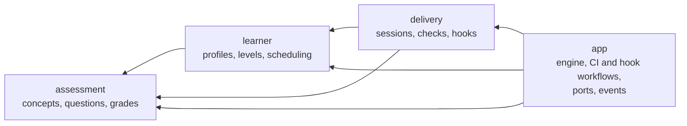

# ADR-0002: Domain model

- **Status:** Accepted
- **Date:** 2026-11-07
- **Refines:** ADR-0001 D2 (hexagonal core) and D7 (adaptive format)

## Context

ADR-0001 isolates the domain from infrastructure, but leaves the domain
itself unmodelled. Domain terms were used without definitions, the domain
types were plain data with public fields, and the rules lived in an
`engine` service: an anaemic domain model. Writing the acceptance tests
showed where the domain was underspecified: what counts as "sustained" for
a level change, what a "mix" of formats is, and what happens when a session
is graded twice (API gaps G2, G3, G4 and G7).

The domain is small, so we adopt DDD's *tactical* patterns and a light
version of the strategic ones: one shared language, aggregates that protect
their own rules, domain events, and contexts as modules, not crates.

## Glossary

The domain language for code, scenarios and conversation. The traceability
tests check that each **Code** name exists in `soqrates-core`, and that the
**Avoid** words do not appear in the feature files.

| Term | Code | Context | Meaning | Avoid |
|---|---|---|---|---|
| Author | `AuthorId` | shared | The identity behind a change (ADR-0003). Its text form is an identity, e.g. `github.com:1001`. | student, developer |
| Learner | `LearnerId` | shared | The person behind one or more identities. Owns exactly one learner profile (ADR-0003). | user |
| Identity | `Identity` | shared | One way a learner shows up: an account on one forge (host plus immutable account ID, e.g. `github.com:1001`) or an e-mail address (`email:<address>`). Usernames are not identities. | alias, login |
| Verification | `Verification` | shared | Whether the forge vouches for an identity. Forge accounts are verified; a commit e-mail on its own is not. | |
| Link | `IdentityLink` | learner | The fact that an identity belongs to a learner. Every identity has at most one link. | alias |
| Link code | `LinkCode` | learner | A short-lived, single-use code that proves one person controls two identities. | token, OTP |
| Learner store | `LearnerStore` | app | The store holding the profiles of linked learners, reachable from several forges. Owned by the learner or by an organisation. | |
| Change | `Diff` | assessment | The unified diff Soqrates asks about. | |
| Concept | `Concept` | assessment | One idea that a change exercises, e.g. Rust borrowing. The unit of learning. | topic, skill |
| Concept scope | `ConceptScope` | assessment | `General` (a technology concept, e.g. `rust.async.cancellation`) or `Project` (specific to one organisation's code, ADR-0003). | |
| Question | `Question` | assessment | A question about one concept, in one format. | exercise |
| Format | `QuestionFormat` | assessment | Multiple choice or open. | |
| Answer | `Answer` | assessment | The author's response to a question. | reply |
| Grade | `Grade` | assessment | Again (wrong), Hard, Good or Easy. Only Again is incorrect. | score, mark |
| Examiner | `Examiner` | assessment | Extracts concepts, writes questions and grades answers. An LLM in production. | grader, model |
| Learner profile | `LearnerProfile` | learner | Everything Soqrates knows about one learner. An aggregate. | learner model, account |
| Level | `Level` | learner | Novice, Intermediate or Expert. Drives the format. | rank, skill level |
| Review card | `ReviewCard` | learner | The FSRS schedule state of one concept for one author. | flashcard |
| Review | `GradedAnswer` | learner | One graded answer recorded on a profile; it reschedules the card. | attempt |
| Due review | `due_reviews` | learner | A concept whose review card is due. It is asked before new concepts. | |
| Session | `Session` | delivery | The questions put to one author about one change, and their grading. An aggregate. Informally a "quiz". | test, exam |
| Session key | `SessionKey` | shared | Identity of a session. In CI: PR plus head commit. | |
| Check | `CheckStatus` | delivery | The status Soqrates reports on a pull request. | |
| Hook | `HookKind` | delivery | A local git `pre-commit` or jj `pre-push` invocation. | |
| Mode | `Mode` | delivery | Advisory (never blocks) or Blocking. | |

## Contexts

Arrows are "may use". All contexts may use the shared kernel (`ids`).

## Decisions

### D1: The glossary is the domain language
**Enforcement:** automated

The glossary above is authoritative. Every **Code** name exists in
`soqrates-core` as a public type, trait or function. Feature files use the
terms and never their **Avoid** synonyms. A new domain term is added to the
glossary in the same change that introduces it.

### D2: Three contexts, as modules with a dependency direction
**Enforcement:** automated

`soqrates-core` is split into the modules `ids` (shared kernel),
`assessment`, `learner`, `delivery` and `app`. Allowed dependencies:

| Module | May use |
|---|---|
| `ids` | none |
| `assessment` | `ids` |
| `learner` | `ids`, `assessment` |
| `delivery` | `ids`, `assessment`, `learner` |
| `app` | everything |

The domain contexts (`assessment`, `learner`, `delivery`) are synchronous,
pure code. They never use `app`, where the ports, async workflows and
events live.

### D3: `LearnerProfile` and `Session` are aggregates
**Enforcement:** automated

Both have private fields. They change only through their own methods, so
that their rules cannot be bypassed:

- `LearnerProfile::record(...)` is the only way to record a review. It
  updates the concept's review card, appends to the history and re-evaluates
  the level, all at once.
- A `Session` is opened with `Session::open(...)`, and grading it with
  `Session::conclude(...)` consumes it.

Serde deserialization is how a store rehydrates them, and is used for
nothing else. The `app` layer orchestrates (load, call the aggregate, save,
emit events) and holds no domain rules.

### D4: Level rules
**Enforcement:** automated

This defines "sustained" from ADR-0001 D7 (gap G2).

- A new author is `Novice`. An author may declare a starting level, which
  is a domain operation: `LearnerProfile::starting_at`.
- Six consecutive correct reviews since the last level change promote the
  author one level.
- Three consecutive incorrect reviews since the last level change demote
  them one level.
- The level never goes below `Novice` or above `Expert`. A level change
  resets the streak.

Demotion is quicker than promotion on purpose: the cost of questions that
are too hard (frustration, people disabling the hook) is higher than the
cost of questions that are too easy.

### D5: Format rule
**Enforcement:** automated

This defines the "mix" from ADR-0001 D7 (gap G3). The `i`-th question
(0-based) of a session has format `format_for(level, i)`:

| Level | Format |
|---|---|
| Novice | always multiple choice |
| Intermediate | multiple choice when `i` is even, open when `i` is odd |
| Expert | always open |

### D6: Session rules
**Enforcement:** automated

- A session holds at most `max_questions` questions, and no two questions
  about the same concept.
- Answers must refer to questions in the session (otherwise `Invalid`), at
  most one answer per question (otherwise `Invalid`). An unanswered
  question is graded `Again`.
- A session is graded at most once. Submitting answers to an unknown or
  already-graded session fails with `NotFound` (gap G7).
- A session passes if the fraction of correct grades is at least
  `pass_threshold`. An empty session passes.

How "at most once" is achieved: submitting claims the session atomically
(`StateStore::take_session`), so of concurrent submissions exactly one
grades it. Grading writes the graded record and the profiles; if any write
fails, all of them are rolled back and the session is given back.

**Known limitation.** The rollback is best effort. A store failure during
rollback, or a crash between the writes, can leave partial state: a lost
session, or a graded record without its reviews. While a submission holds
the claim, a CI check from a caller outside the workflow's concurrency
group sees neither a pending nor a graded session and may open a new one
for the same key. Closing this needs
durable multi-write atomicity, such as a write-ahead grading journal
recovered at the start of each run. It is deferred: CI runs are serialised,
and the stores have no transactions.

### D7: Domain events
**Enforcement:** automated

Aggregates return domain events describing what happened, and
`SessionOutcome` carries them:

| Event | Emitted by | When |
|---|---|---|
| `ReviewRecorded` | `LearnerProfile::record` | always |
| `ReviewScheduled` | `LearnerProfile::record` | always, with the new due date |
| `LevelChanged` | `LearnerProfile::record` | when D4 changes the level |
| `SessionGraded` | `Session::conclude` | always, with the number of correct answers, the total and whether it passed |

The events are the input for evals (ADR-0001 D13), for example retention
and level calibration, and for explaining outcomes to the author. For now
they are returned, not published. A publishing port can be added when
something needs it.

### D8: Order of due reviews
**Enforcement:** automated

Due reviews are ordered by due time, earliest first, with ties broken by
concept ID in ascending order (gap G4).

## Consequences

- Rules live next to the data they protect. The engine shrinks to
  orchestration, and domain behaviour can be tested without async code or
  fakes.
- The gaps G2, G3, G4 and G7 are settled. Their scenarios assert the rules
  above.
- The module dependency rules are checked like the crate rules, so they
  cannot erode silently.
- Private fields mean tests and adapters must use accessors and domain
  operations. Setting up a scenario at a given level uses
  `LearnerProfile::starting_at`.
