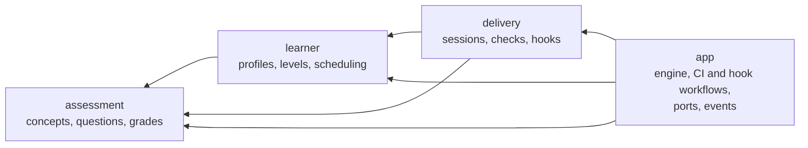

# ADR-0002: Domain model

- **Status:** Accepted
- **Date:** 2026-11-07
- **Refines:** ADR-0001 D2 (hexagonal core) and D7 (adaptive format)

## Context

ADR-0001 isolates the domain from infrastructure, but leaves the domain
itself unmodelled. Domain terms were used without definitions, the domain
types were plain data with public fields, and the rules lived in an
`engine` service: an anaemic domain model. Writing the acceptance tests
showed where the domain was underspecified: what counts as "sustained" for
a level change, what a "mix" of formats is, and what happens when a session
is graded twice (API gaps G2, G3, G4 and G7).

The domain is small, so we adopt DDD's *tactical* patterns and a light
version of the strategic ones: one shared language, aggregates that protect
their own rules, domain events, and contexts as modules, not crates.

## Glossary

The domain language for code, scenarios and conversation. The traceability
tests check that each **Code** name exists in `soqrates-core`, and that the
**Avoid** words do not appear in the feature files.

| Term | Code | Context | Meaning | Avoid |
|---|---|---|---|---|
| Author | `AuthorId` | shared | The identity behind a change (ADR-0003). Its text form is an identity, e.g. `github.com:1001`. | student, developer |
| Learner | `LearnerId` | shared | The person behind one or more identities. Owns exactly one learner profile (ADR-0003). | user |
| Identity | `Identity` | shared | One way a learner shows up: an account on one forge (host plus immutable account ID, e.g. `github.com:1001`) or an e-mail address (`email:<address>`). Usernames are not identities. | alias, login |
| Verification | `Verification` | shared | Whether the forge vouches for an identity. Forge accounts are verified; a commit e-mail on its own is not. | |
| Link | `IdentityLink` | learner | The fact that an identity belongs to a learner. Every identity has at most one link. | alias |
| Link code | `LinkCode` | learner | A short-lived, single-use code that proves one person controls two identities. | token, OTP |
| Learner store | `LearnerStore` | app | The store holding the profiles of linked learners, reachable from several forges. Owned by the learner or by an organisation. | |
| Change | `Diff` | assessment | The unified diff Soqrates asks about. | |
| Concept | `Concept` | assessment | One idea that a change exercises, e.g. Rust borrowing. The unit of learning. | topic, skill |
| Concept scope | `ConceptScope` | assessment | `General` (a technology concept, e.g. `rust.async.cancellation`) or `Project` (specific to one organisation's code, ADR-0003). | |
| Question | `Question` | assessment | A question about one concept, in one format. | exercise |
| Format | `QuestionFormat` | assessment | Multiple choice or open. | |
| Kind | `QuestionKind` | assessment | What a question asks of the author, e.g. predict an outcome or explain their change (ADR-0007). Separate from the format. | |
| Code snippet | `CodeSnippet` | assessment | Code shown with a question: a language and about 15 lines (at most 20), from the change or written by the examiner (ADR-0007). | |
| Hunk | `Hunk` | assessment | A contiguous piece of a change in one file, as it is after the change. | |
| Brief | `QuestionBrief` | assessment | What the examiner is asked to write for one concept: the format, the kinds allowed and the hunks (ADR-0007). | |
| Answer | `Answer` | assessment | The author's response to a question. | reply |
| Grade | `Grade` | assessment | Again (wrong), Hard, Good or Easy. Only Again is incorrect. | score, mark |
| Examiner | `Examiner` | assessment | Extracts concepts, writes questions and grades answers. An LLM in production. | grader, model |
| Codebase | `Codebase` | app | The repository at the revision a change produces, as the examiner may read it: its files, searches and history, from git, never the working tree (ADR-0008). In CI it comes from a checkout of the pull request. | workspace |
| Learner profile | `LearnerProfile` | learner | Everything Soqrates knows about one learner. An aggregate. | learner model, account |
| Level | `Level` | learner | Novice, Intermediate or Expert. Drives the format. | rank, skill level |
| Review card | `ReviewCard` | learner | The FSRS schedule state of one concept for one author. | flashcard |
| Review | `GradedAnswer` | learner | One graded answer recorded on a profile; it reschedules the card. | attempt |
| Due review | `due_reviews` | learner | A concept whose review card is due. It is asked before new concepts. | |
| Session | `Session` | delivery | The questions put to one author about one change, and their grading. An aggregate. Informally a "quiz". | test, exam |
| Session key | `SessionKey` | shared | Identity of a session. In CI: PR plus head commit. | |
| Grading journal | `GradingJournal` | delivery | The graded record and learner profiles that grading one session writes, stored before any of them. While it is stored, the session is being graded. | |
| Round | `Round` | delivery | What Soqrates asked about one head of a pull request: the session that answers for that head, and the concepts it asked. | |
| Rounds | `PrRounds` | delivery | The rounds of one pull request, oldest first. | |
| Question bank | `BankedQuestion` | delivery | The questions Soqrates wrote, kept per concept so that later rounds can ask them again instead of writing new ones. Holds only checked, general questions without code from a change (ADR-0009). | question pool |
| Seen questions | `SeenQuestions` | delivery | Which bank questions one learner was shown, and in which of their rounds, so none is shown twice within a few rounds (ADR-0009). Kept with the bank, never in the learner store. | |
| Asked questions | `AskedSession` | delivery | The questions of one graded session as they were asked, with the author's answers, grades and the explanations shown, kept for feedback in the store of the author's sessions, never in the learner store. Never asked again (ADR-0011). | |
| Question feedback | `QuestionFeedback` | delivery | What the author of a graded session said about one of its questions: a kind (disagree, unclear, wrong explanation, off-topic, good) and optional text. Never changes a grade (ADR-0011). | complaint, appeal |
| Follow-up | `FollowUp` | delivery | A round of new questions on the same commit about the concepts a graded session got wrong (ADR-0010). Its session is keyed `…#2`, `#3`. | retry, retake |
| Check | `CheckStatus` | delivery | The status Soqrates reports on a pull request. | |
| Hook | `HookKind` | delivery | A local git `pre-commit` or jj `pre-push` invocation. | |
| Mode | `Mode` | delivery | Advisory (never blocks) or Blocking. | |

## Contexts

Arrows are "may use". All contexts may use the shared kernel (`ids`).

## Decisions

### D1: The glossary is the domain language
**Enforcement:** automated

The glossary above is authoritative. Every **Code** name exists in
`soqrates-core` as a public type, trait or function. Feature files use the
terms and never their **Avoid** synonyms. A new domain term is added to the
glossary in the same change that introduces it.

### D2: Three contexts, as modules with a dependency direction
**Enforcement:** automated

`soqrates-core` is split into the modules `ids` (shared kernel),
`assessment`, `learner`, `delivery` and `app`. Allowed dependencies:

| Module | May use |
|---|---|
| `ids` | none |
| `assessment` | `ids` |
| `learner` | `ids`, `assessment` |
| `delivery` | `ids`, `assessment`, `learner` |
| `app` | everything |

The domain contexts (`assessment`, `learner`, `delivery`) are synchronous,
pure code. They never use `app`, where the ports, async workflows and
events live.

### D3: `LearnerProfile` and `Session` are aggregates
**Enforcement:** automated

Both have private fields. They change only through their own methods, so
that their rules cannot be bypassed:

- `LearnerProfile::record(...)` is the only way to record a review. It
  updates the concept's review card, appends to the history and re-evaluates
  the level, all at once.
- A `Session` is opened with `Session::open(...)`, and grading it with
  `Session::conclude(...)` consumes it.

Serde deserialization is how a store rehydrates them, and is used for
nothing else. The `app` layer orchestrates (load, call the aggregate, save,
emit events) and holds no domain rules.

### D4: Level rules
**Enforcement:** automated

This defines "sustained" from ADR-0001 D7 (gap G2).

- A new author is `Novice`. An author may declare a starting level, which
  is a domain operation: `LearnerProfile::starting_at`.
- Six consecutive correct reviews since the last level change promote the
  author one level.
- Three consecutive incorrect reviews since the last level change demote
  them one level.
- The level never goes below `Novice` or above `Expert`. A level change
  resets the streak.

Demotion is quicker than promotion on purpose: the cost of questions that
are too hard (frustration, people disabling the hook) is higher than the
cost of questions that are too easy.

### D5: Format rule
**Enforcement:** automated

This makes ADR-0001 D7 precise. Every question of a session has the same
format, `format_for(level, open_questions)`:

| Level | `open_questions` off (default) | `open_questions` on |
|---|---|---|
| Novice | multiple choice | multiple choice |
| Intermediate | multiple choice | multiple choice |
| Expert | multiple choice | open |

Intermediates used to alternate, multiple choice on even and open on odd
questions; a round that switches formats midway read as arbitrary, so no
level mixes formats any more. Open questions are off by default until their
grading has been evaluated; `open_questions = true` in the configuration
(or `SOQRATES_OPEN_QUESTIONS=true`) turns them on for experts. Open
questions already asked, e.g. carried into a later round (D9), are still
graded as open.

The kind of each question is chosen by the examiner, steered by the level
(ADR-0007 D2).

### D6: Session rules
**Enforcement:** automated

- A session holds at most `max_questions` questions (D10: more only when
  carried questions alone exceed a lowered cap), and no two questions
  about the same concept.
- Answers must refer to questions in the session (otherwise `Invalid`), at
  most one answer per question (otherwise `Invalid`). An unanswered
  question is graded `Again`.
- A session is graded at most once. Submitting answers to an unknown or
  already-graded session fails with `NotFound` (gap G7).
- A session passes if the fraction of correct grades is at least
  `pass_threshold`. An empty session passes.
- *Amended by [ADR-0010](0010-follow-up-rounds.md):* a session is graded
  once, but a commit is not final: its wrong answers get a follow-up round,
  a new session keyed `…#2`. A follow-up passes on the first round's
  concepts, each counted with its latest answer, and records no reviews.

How "at most once" is achieved: grading is written ahead, in a grading
journal kept with the session.

1. **Grade.** The examiner grades the answers and the engine works out the
   graded record and the reviews to add: for each question, the concept,
   format, grade, time and identity (what `LearnerProfile::record` takes)
   and the store whose profile gets it (ADR-0003 D4, D5). Nothing is
   written yet. The `SessionOutcome` (level after, events, next review
   dates) is worked out from the profiles as they are now.
2. **Claim.** In one atomic step (`StateStore::begin_grading`), the pending
   session is removed and a journal entry holding the session, the graded
   record and the reviews is stored. The journal holds what happened, not
   what the profiles should look like afterwards: a whole profile in it
   would, when applied, replace the reviews another session of the same
   learner added meanwhile. Of concurrent submissions exactly one claims
   the session; the others fail with `NotFound`. A failure before this
   step leaves the session pending.
3. **Apply.** For each profile the reviews go to, the engine loads it
   fresh, records the journaled reviews on it and saves it with
   `StateStore::save_profile_if_current`: a profile carries a version, and
   the save is refused, saving nothing, if the stored profile is no longer
   the version that was loaded (an optimistic check, one step in every
   store). On a refusal the engine loads, records and saves again, so of
   several sessions of one learner graded at the same moment all reviews
   end up on the profile. The profile also keeps an opaque mark of every
   session whose reviews it holds, and records the reviews of a session
   only if its mark is not there yet, so applying again records nothing
   twice. The marks are opaque so that the learner store holds no PR
   reference (ADR-0003 D5); they are never removed, one per graded session
   per profile, which is acceptable for now. Then the session is removed if
   a file store still holds it, then the graded record.
4. **Commit.** The journal entry is removed.

The `SessionOutcome` is then corrected to what was recorded: the level,
the events and the next review dates come from the profiles the reviews
landed on, which may differ from those grading saw if another session was
graded meanwhile.

Journals written before the reviews were journaled hold the whole profiles
to save instead (`profiles`, and no `reviews`). Such a journal is applied
the old way, once: its profiles are saved, unless the graded record shows
that was done. Profiles stored without a version or marks load as version 0
with none.

While the entry exists, the session is being graded. Every engine operation
that touches a learner or a session first finishes the entries left behind,
e.g. by a crash or a failed write, by applying them again. Entries whose
graded record exists only need removing. An operation that can't finish
an entry fails, except looking up a session: the CI check then reports
"being graded" rather than asking again. It looks a session up in the
order grading moves it, pending, being graded, graded, so it never misses a
grading by another run and never opens a second session for its key.

### D7: Domain events
**Enforcement:** automated

Aggregates return domain events describing what happened, and
`SessionOutcome` carries them:

| Event | Emitted by | When |
|---|---|---|
| `ReviewRecorded` | `LearnerProfile::record` | always |
| `ReviewScheduled` | `LearnerProfile::record` | always, with the new due date |
| `LevelChanged` | `LearnerProfile::record` | when D4 changes the level |
| `SessionGraded` | `Session::conclude` | always, with the number of correct answers, the total and whether it passed |

The events are the input for evals (ADR-0001 D13), for example retention
and level calibration, and for explaining outcomes to the author. For now
they are returned, not published. A publishing port can be added when
something needs it.

### D8: Order of due reviews
**Enforcement:** automated

Due reviews are ordered by due time, earliest first, with ties broken by
concept ID in ascending order (gap G4).

### D9: A round asks about what changed and what is still unanswered
**Enforcement:** automated

Every push to a pull request starts a round, recorded in the PR's
`PrRounds` with its head, its session and the concepts it asked. The CI
check (ADR-0001 D8) decides each new round like this:

- **Incremental change.** The first round asks about the whole pull
  request. A later round asks about the change to the new head
  (`ScmProvider::diff_between`) from the head of the latest round that
  asked its own questions, not one that carried an earlier session forward:
  that round asked nothing about its head, e.g. because carried questions
  filled the budget (D10), so its changes are asked about now. The change
  is restricted to the files the pull request's own diff touches, so that
  merging the base branch doesn't bring in other people's changes. After
  a force-push, when the old head is not an ancestor of the new one, the
  whole pull request is asked about.
- **Unanswered questions are carried forward.** When the latest round's
  session is still pending, a later round starts with its questions, reused
  as written: no model call, and the author sees the same questions again.
  Questions about the change follow (D10). The earlier question comment is
  frozen as superseded (ADR-0004 D7), so the new comment holds both. So a
  push can't make unanswered questions disappear.
- **Submitted answers are graded first.** When the latest round's session
  is still pending but its answers were submitted (ADR-0004 D3), e.g.
  because a push landed before the run that grades them, the new round
  grades that session first: its results are posted and its reviews
  recorded, as on a run for its own head. It is then a graded round: not
  carried, and its concepts count as asked. Its grade sets no check on the
  new head, whose check is about the new round; with nothing new to ask,
  its result is reported again, as below. Answers ticked but not
  submitted, or given by anyone but the author, don't count: the questions
  are carried. A re-run doesn't grade again (D6).
- **No repeats within a pull request.** Concepts of graded rounds, and the
  carried ones, are not asked again, unless their review card is due: due
  reviews come first as always (ADR-0001 D6). Concepts of a round that was
  superseded before it was graded are not skipped: they were carried into
  the next round.
- **Nothing new.** When a later round has nothing new to ask, the new head
  carries the latest round's session forward instead of asking an empty
  round or reposting the same questions. If that session is still pending,
  its question comment stays open, and answering it sets the check on the
  new head. If it was graded, its result is reported again. So a push can't
  wipe out a failed or unanswered round by asking nothing.

A round records every concept its session asks, carried ones included.
The rounds hold heads, session keys and concept IDs, no question or answer
text, and are kept with the author's sessions: in the organisation's store
when there is one, never in the shared learner store (ADR-0003 D5). The
round is recorded after its questions are posted. If recording fails, the
next run records it from the pending session; a round whose session is
gone, e.g. because posting failed, is asked again.

### D10: A session is sized to the change and the author's knowledge
**Enforcement:** automated

`max_questions` (default 5) is a cap, not a target. A session about a diff
is built from four sources, in this order:

1. **Carried questions** (D9, CI only): the unanswered questions of the
   latest round, as written. They are never dropped. They count towards the
   cap; if the cap was lowered since, they all stay anyway.
2. **Due reviews**, ordered by D8.
3. **New concepts** the examiner extracts from the diff, each with a
   weight: `core` (the change is about it), `supporting` (the change relies
   on it) or `incidental` (the change merely touches it). Incidental
   concepts are not asked. Core concepts come before supporting ones, each
   in the examiner's order.
4. Concepts the author already **knows** are skipped: an extracted concept
   with a review card that isn't due yet. Its schedule brings it back at the
   right time (ADR-0001 D6).

After the carried questions, due reviews and new concepts share the
remaining slots. New concepts are guaranteed half of them, rounded up, or
as many as there are if fewer; due reviews take what they leave; new
concepts take any slots the reviews don't use. So reviews come first but
never crowd out the change, and a change with nothing new still gets its
reviews.

Zero questions is a valid outcome: a change whose concepts are all
incidental, or known and not due, asks nothing (ADR-0004 D7). An empty
diff asks nothing at all, not even due reviews (ADR-0001 D9).

The format of a new question follows D5, with `i` its position in the
session; carried questions keep the format they were asked in.

A carried question can be stale when the push removed the code it asks
about. Rounds don't record which files a concept came from, so this is
accepted for now.

## Consequences

- Rules live next to the data they protect. The engine shrinks to
  orchestration, and domain behaviour can be tested without async code or
  fakes.
- The gaps G2, G3, G4 and G7 are settled. Their scenarios assert the rules
  above.
- The module dependency rules are checked like the crate rules, so they
  cannot erode silently.
- Private fields mean tests and adapters must use accessors and domain
  operations. Setting up a scenario at a given level uses
  `LearnerProfile::starting_at`.
